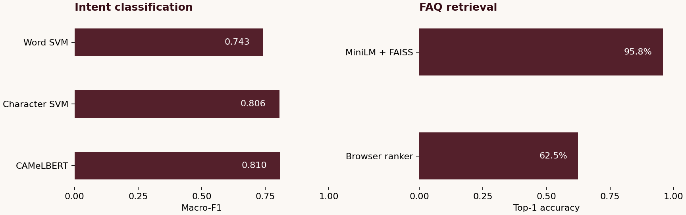
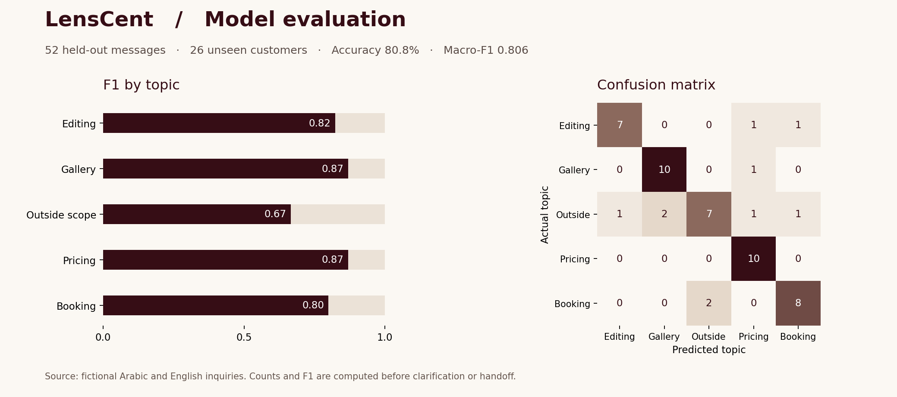

# LensCent Inquiry Studio

**Where Vision Meets Precision**  
An Arabic–English inquiry assistant for a Saudi photography studio. Built for SDAIA’s Applied Natural Language Processing Bootcamp @SDAIAAcademy.

> **Customer** · «أبغى أحجز جلسة تصوير تخرج في الرياض يوم الخميس»  
> **Studio brief** · Booking · Graduation shoot · Riyadh · Thursday

With the city present, the draft acknowledges Riyadh. When the same message omits the city, the draft asks for that one missing detail. Availability stays with the studio team.

## 1 · From inquiry to reply

1. **A customer writes in their own words.** The dataset covers Saudi and other Arabic dialects, Modern Standard Arabic, and English. Preprocessing normalizes spelling, reduces Arabic letter runs of three or more to one, and masks email addresses and Saudi mobile numbers. Ordinary letter pairs remain intact.
2. **The classifier identifies the request.** A character-level TF-IDF vector feeds a linear SVM with five categories — booking, pricing, editing, gallery access, and outside scope. A narrow decision margin triggers a clarification.
3. **The reply has a source.** Eight bilingual FAQ entries cover the four studio services. During training, multilingual MiniLM and FAISS score matching questions. A compact Ridge model learns those scores for browser use.
4. **The draft reflects the details already supplied.** Explicit rules extract the service, city, and date. The dashboard shows the draft alongside its FAQ source for human review.

The same preprocessing runs in Python and in the browser, before classification and detail extraction.

| Customer text | Normalized model input |
| --- | --- |
| غيرررروا موعد الحجززززز! | غيروا موعد الحجز |
| أبييي أحجززز تصويررر | ابي احجز تصوير |
| الله يسلمك | الله يسلمك |

## 2 · What the evaluation shows

- **Dataset.** 204 fictional messages from 102 simulated customers. The customer split assigns 120 messages to training, 32 to validation, and 52 to testing. Each customer belongs to one partition.
- **Intent classification.** The browser model labeled 42 of 52 held-out messages correctly. Macro-F1 gives each category equal weight. The compact classifier reached 0.806, close to the fine-tuned CAMeLBERT result of 0.810.
- **Language coverage.** The browser model classified 36 of 40 Arabic messages and 6 of 12 English messages correctly. The smaller English sample and lower score make English inquiries a priority for further evaluation.



- **FAQ retrieval.** On 24 independently labeled questions, direct semantic search ranked the correct FAQ first 23 times. The browser ranker did so 15 times and placed it in the top three 22 times. That gap is the trade-off behind the offline demo.
- **Error analysis.** Gallery and pricing reached an F1 of about 0.87 each. Outside-scope inquiries were harder at 0.67. Each off-diagonal cell below counts messages assigned to a different topic. The interactive dashboard exposes the underlying examples.



## 3 · Exploring the project

- **Offline demo.** The downloaded HTML opens directly in a browser. Fonts, brand assets, and model weights are embedded. [LensCent_Demo.html](LensCent_Demo.html)
- **Notebook.** Eight sections cover normalization, customer splits, training, evaluation, demo export, and transformer experiments. The setup cell accepts the project ZIP in Colab. [LensCent_Final_Colab.ipynb](LensCent_Final_Colab.ipynb)
- **Data and predictions.** The labeled messages, FAQ entries, and retrieval questions accompany the per-message test results. [Dataset](data/) · [Evaluation outputs](outputs/)
- **Implementation.** Python handles training and evaluation. The browser runs the exported model locally. [Training pipeline](train.py) · [Browser inference](web/engine.js) · [Interface](web/)

## 4 · Reproducing the results

The core workflow uses Python 3.12 and the cached teacher scores included in the repository.

```bash
python -m pip install -r requirements.txt
python train.py
python plots.py
python benchmark_chart.py
python export_html.py
```

The optional neural workflow rebuilds the semantic targets and repeats the CAMeLBERT experiment. The first run downloads pretrained weights.

```bash
python -m pip install -r requirements-neural.txt
python prepare_teacher.py
python transformer_lab.py --task finetune
python train.py
python plots.py
python benchmark_chart.py
python export_html.py
```

The reported scores describe a small, authored dataset with one primary intent per message. Multi-request messages and real customer traffic remain open evaluation cases.
